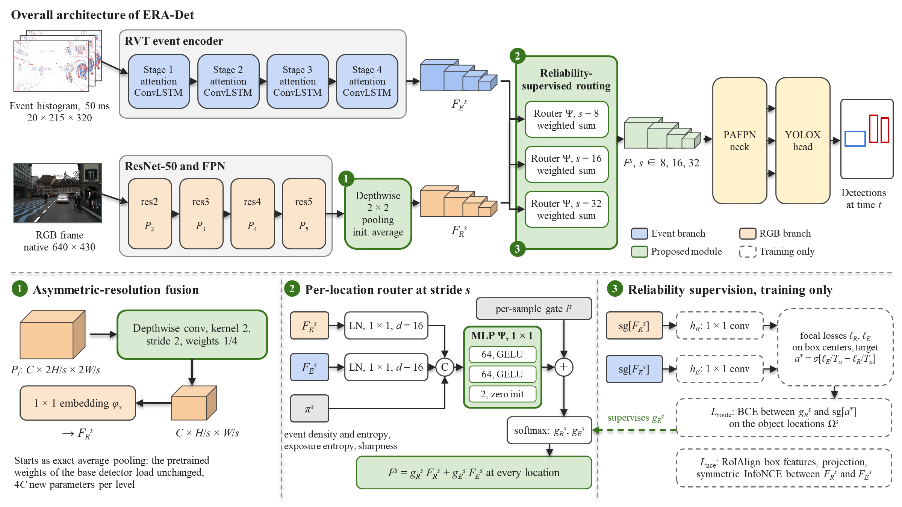
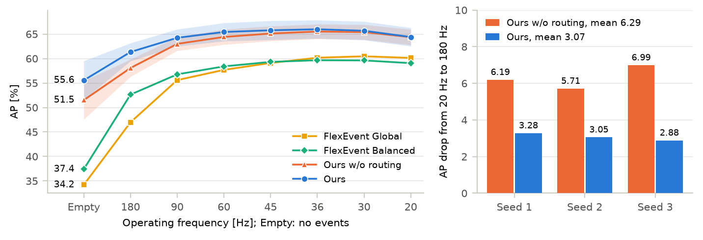

<div align="center">

# ERA-Det

### RGB-Event Object Detection Across Operating Frequencies via Reliability-Supervised Routing and Asymmetric-Resolution Fusion

Peijun Shi, Jiannan Zhao, Xiujin Zhu, Zhenguo Lao, Chee-Onn Chow, Wei Ru Wong

Universiti Malaya · Guangxi University · University of Lincoln

[](https://arxiv.org/abs/2610.26090)

</div>

> **The paper has been submitted to IEEE Transactions on Image Processing. Code, configs and pretrained weights will be released once the paper is accepted.** Watch or star this repository to be notified.

## Overview

An event camera lets an RGB-event detector decide between frames. The rate of these decisions, the **operating frequency**, is a decision rate and not the frame rate of the camera: on DSEC-Det the frames arrive at 20 Hz, and at an operating frequency of 180 Hz nine decisions share one frame. As the operating frequency rises, each decision receives a shorter and sparser event window, and the reliability of the events relative to the frame changes over the scene and over time.

ERA-Det fuses the two sensors by this relative reliability, location by location and decision by decision.

- **Reliability-supervised routing (RSR)** predicts a fusion weight at every location of the feature pyramid and supervises it with targets derived from the losses of two single-modality classifiers. The classifiers act as teachers during training only; at inference the router predicts the weights from the features alone.
- **Asymmetric-resolution fusion (ARF)** gives the frame the evidence that routing relies on. The event encoder runs at every decision, the RGB encoder only once per frame, so ARF keeps the events at the resolution of the base detector, encodes the frame at its native resolution and maps every RGB feature level onto the event grid with a depthwise pooling initialized as exact averaging. All pretrained weights of the base detector load unchanged.

<p align="center">
  
</p>

## Highlights

- **New state of the art on the DSEC-Det dataset:** 63.2 mAP, 3.7 mAP above FlexEvent.
- **Most accurate at every operating frequency** from 20 Hz to 180 Hz and without events. At 180 Hz, ERA-Det reaches 61.3 mAP and is more accurate than FlexEvent at 20 Hz.
- **Routing halves the accuracy loss** from 20 Hz to 180 Hz, from 6.3 to 3.1 mAP, and lowers it in every training seed and with seven classes.
- **Transfers to DAVIS346 sensors:** asymmetric-resolution fusion reaches the best reported results on the PKU-DDD17-Car dataset and the best reported AP<sub>50</sub> on the PKU-DAVIS-SOD dataset, and the router lowers the frame weight at night and in low light and raises it when the events vanish.
- **Cheap to obtain:** ERA-Det upgrades the released FlexEvent weights in 5,000 iterations on a single GPU.

## Results

### DSEC-Det, two classes, test split

AP at each operating frequency under the interframe protocol of DAGr and FlexEvent; the frames stay at 20 Hz. Empty: detection without events. Drop: AP<sub>20 Hz</sub> − AP<sub>180 Hz</sub>. Our models: mean over three training seeds.

| Method | Global mAP | Empty | 180 Hz | 20 Hz | Drop | Retention |
|:--|:-:|:-:|:-:|:-:|:-:|:-:|
| FlexEvent Global | 59.53 | 34.20 | 46.98 | 60.12 | 13.14 | 78.1% |
| FlexEvent Balanced | 58.16 | 37.40 | 52.64 | 59.06 | 6.42 | 89.1% |
| ERA-Det w/o routing (FlexEvent + ARF) | **63.41** | 51.51 | 58.07 | 64.37 | 6.29 | 90.2% |
| **ERA-Det** | 63.18 | **55.55** | **61.34** | **64.40** | **3.07** | **95.2%** |

<p align="center">
  
</p>

### DSEC-Det, eight-class protocol

| Method | Global mAP | 180 Hz | Drop |
|:--|:-:|:-:|:-:|
| FlexEvent Global | 53.40 | 41.85 | 12.77 |
| FlexEvent Balanced | 51.76 | 45.57 | 7.81 |
| ERA-Det w/o routing (FlexEvent + ARF) | 55.12 | 48.58 | 7.68 |
| **ERA-Det** | **55.71** | **52.01** | **4.89** |

### PKU-DDD17-Car and PKU-DAVIS-SOD

Fine-tuned from the DSEC-Det models; mean over three training seeds.

| Method | PKU-DDD17-Car mAP | PKU-DDD17-Car AP<sub>50</sub> | PKU-DAVIS-SOD mAP | PKU-DAVIS-SOD AP<sub>50</sub> |
|:--|:-:|:-:|:-:|:-:|
| Best reported | 46.0 (CAFR) | 86.7 (CAFR) | **30.5** (FAOD) | 57.5 (FAOD) |
| FlexEvent | 52.06 | 89.91 | 28.97 | 56.62 |
| ERA-Det w/o routing (FlexEvent + ARF) | **52.99** | **91.20** | 29.85 | **58.52** |
| ERA-Det | 51.61 | 89.31 | 29.77 | 58.17 |

## Release plan

- [ ] Training and evaluation code
- [ ] Configs for DSEC-Det, two and eight classes, PKU-DDD17-Car and PKU-DAVIS-SOD
- [ ] Pretrained weights
- [ ] Interframe evaluation and routing visualization scripts

## Citation

If you find ERA-Det useful, please cite:

```bibtex
@misc{shi2026eradet,
  title         = {{RGB}--Event Object Detection Across Operating Frequencies via Reliability-Supervised Routing and Asymmetric-Resolution Fusion},
  author        = {Shi, Peijun and Zhao, Jiannan and Zhu, Xiujin and Lao, Zhenguo and Chow, Chee-Onn and Wong, Wei Ru},
  year          = {2026},
  eprint        = {2610.26090},
  archivePrefix = {arXiv},
  primaryClass  = {cs.CV},
  url           = {https://arxiv.org/abs/2610.26090}
}
```

## Acknowledgements

ERA-Det builds on [FlexEvent](https://flexevent.github.io) ([paper](https://arxiv.org/abs/2412.06708)), [RVT](https://github.com/uzh-rpg/RVT), [YOLOX](https://github.com/Megvii-BaseDetection/YOLOX) and [detectron2](https://github.com/facebookresearch/detectron2), and uses the [DSEC-Detection](https://github.com/uzh-rpg/dsec-det) dataset. We thank their authors for releasing their code, models and data.

## Contact

For questions, please open an issue in this repository.
